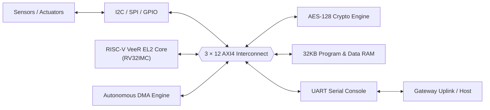
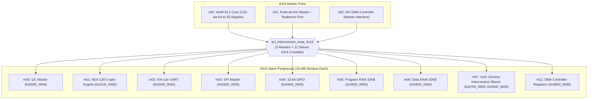

<div align="center">

# 🔐 Secure IoT Gateway SoC

**A RISC-V VeeR EL2-powered System-on-Chip featuring a high-performance 3 × 12 AXI4 Interconnect connecting hardware cryptography (AES-128), autonomous DMA, dual SRAMs, and essential industrial communication peripherals (I2C, UART, SPI, GPIO) — fully verified using bare-metal C firmware with Synopsys VCS and Verdi.**

[](https://github.com/guntabhumesh/Secure-IoT-Gateway-SoC)
[](rtl/)
[-0b7285)](rtl/interconnect/axi_interconnect_wrap_3x12.v)
[-f08c00)](rtl/core/)
[-c92a2a)](rtl/aes/rtl/axi_aes_slave.v)
[](rtl/dma/)
[](scripts/sim/)
[](#-verification-results)

[Overview](#-overview) · [Architecture](#-architecture) · [Address Map](#-soc-address-map) · [All-IP Firmware](#-all-ip-firmware-verification) · [Quick Start](#-quick-start) · [Register Maps](#-register-maps) · [Author](#-author)

</div>

---

## 📑 Table of Contents

1. [Overview](#-overview)
2. [Highlights](#-highlights)
3. [Architecture](#-architecture)
4. [SoC Address Map](#-soc-address-map)
5. [Repository Layout](#-repository-layout)
6. [All-IP Firmware Verification](#-all-ip-firmware-verification)
7. [Verification Results](#-verification-results)
8. [Quick Start & Simulation](#-quick-start)
9. [Register Maps](#-register-maps)
10. [Third-Party IP & Licenses](#-third-party-ip-and-licenses)
11. [Author](#-author)

---

## 🧭 Overview

The **Secure IoT Gateway SoC** is engineered as a secure edge controller capable of gathering sensor data, executing cryptographic encryption in hardware, moving data autonomously via DMA, and communicating over serial interfaces without bottlenecking the main CPU core.



---

## ✨ Highlights

- **3 × 12 AXI4 High-Performance Interconnect**:
  - **3 Master Ports**: VeeR EL2 CPU LSU (`s00`), External AXI Master (`s01`), and Autonomous DMA Master (`s02`).
  - **12 Slave Ports**: 16 MB (`2^24`) address decode window per slave.
  - Round-robin and priority arbitration with split address/data channels.
- **Hardware Cryptography**:
  - NIST FIPS-197 compliant 128-bit AES encryption & decryption accelerator (`0x0100_0000`).
- **Autonomous Direct Memory Access (DMA)**:
  - Hardware memory-to-memory burst copy engine (`0x0B00_0000`) capable of high-throughput transfers between internal SRAMs and peripherals without CPU intervention.
- **Embedded RISC-V Core**:
  - CHIPS Alliance **VeeR EL2** superscalar core (RV32IMC) with dual-issue pipeline, 64-to-32 bit LSU AXI adapter, 4-bank ICCM and DCCM with SECDED ECC error protection.
- **Full Industrial Peripheral Set**:
  - **I2C Master** (`0x0000_0000`): Open-drain bidirectional bus controller.
  - **UART** (`0x0200_0000`): Full-duplex with TX/RX FIFOs, baud rate generator, and loopback support.
  - **SPI Master** (`0x0300_0000`): Multi-mode byte exchange controller.
  - **GPIO** (`0x0400_0000`): 32-bit bidirectional I/O with atomic bit set, clear, and toggle registers.
  - **Dual AXI SRAMs**: 32 KB Program RAM (`0x0500_0000`) and 32 KB Data RAM (`0x0600_0000`).
- **100% Firmware-Driven Verification**:
  - Bare-metal RISC-V C firmware (`soc_all_ip_test.c`) boots out of ICCM, executes real hardware operations on all peripherals, and reports status over UART.
- **One-Click VCS & Verdi Flow**:
  - Automated bash script (`run_soc_all_ip_veer.sh`) builds firmware, compiles RTL, executes simulation, and loads Verdi waveforms.

---

## 🏗 Architecture

### Top-Level Interconnect Structure



---

## 🗺 SoC Address Map

Every slave owns a 16 MB (`2^24`) address decode range:

| Master Port / Slave | Base Address | End Address | IP Block | Function |
|:---:|:---:|:---:|:---|:---|
| **`m00`** | `0x0000_0000` | `0x00FF_FFFF` | **I2C Master** | Wishbone B4 bridge to I2C controller |
| **`m01`** | `0x0100_0000` | `0x01FF_FFFF` | **AES-128** | NIST FIPS-197 encrypt / decrypt accelerator |
| **`m02`** | `0x0200_0000` | `0x02FF_FFFF` | **UART** | 16550-compatible serial interface with FIFOs |
| **`m03`** | `0x0300_0000` | `0x03FF_FFFF` | **SPI Master** | Synchronous serial peripheral byte exchange |
| **`m04`** | `0x0400_0000` | `0x04FF_FFFF` | **GPIO** | 32-bit bidirectional I/O with atomic set/clr/tgl |
| **`m05`** | `0x0500_0000` | `0x05FF_FFFF` | **Program RAM** | 32 KB AXI SRAM (source buffer for DMA) |
| **`m06`** | `0x0600_0000` | `0x06FF_FFFF` | **Data RAM** | 32 KB AXI SRAM (destination buffer for DMA) |
| **`m07`** | `0x0700_0000` | `0x07FF_FFFF` | **Dummy 0** | Reserved / Interconnect routing verification |
| **`m08`** | `0x0800_0000` | `0x08FF_FFFF` | **Dummy 1** | Reserved / Interconnect routing verification |
| **`m09`** | `0x0900_0000` | `0x09FF_FFFF` | **Dummy 2** | Reserved / Interconnect routing verification |
| **`m10`** | `0x0A00_0000` | `0x0AFF_FFFF` | **Dummy 3** | Reserved / Interconnect routing verification |
| **`m11`** | `0x0B00_0000` | `0x0BFF_FFFF` | **DMA CSRs** | Configuration registers for autonomous DMA |

---

## 📁 Repository Layout

```text
Secure-IoT-Gateway-SoC/
├── README.md                              # SoC Architecture & Verification documentation
├── .gitignore                             # Git ignore rules (excludes all simulation/build artifacts)
├── .gitmodules                            # Submodule references (rtl/core, rtl/dma, rtl/gpio)
├── doc/                                   # Architecture documents, datasheets & test plans
│   ├── Secure_IoT_Gateway_Architecture_Revised_No_JTAG_Signals_No_5_2-2.pdf
│   └── Secure_IoT_Gateway_SoC_UVM_Test_Plan.xlsx
├── firmware/                              # Bare-metal RISC-V firmware source
│   ├── startup.S                          # Bootloader, trap vectors & stack setup
│   ├── link_iccm.ld                       # Linker script targeting VeeR ICCM (0xEE000000)
│   ├── soc_all_ip_test.c                  # Comprehensive All-IP functional verification test
│   └── uart_rw.c                          # Standalone UART read/write diagnostic test
├── rtl/                                   # Synthesizable RTL source files
│   ├── core/                              # VeeR EL2 RISC-V core submodule
│   ├── interconnect/                      # 3x12 Interconnect crossbar, arbiter, priority encoder
│   ├── top/                               # soc_top_with_veer.v & axi_64to32_adapter.sv
│   ├── aes/                               # AES-128 cryptographic engine & AXI slave
│   ├── dma/                               # Autonomous AXI DMA controller & CSRs
│   ├── uart/                              # AXI UART core, FIFOs & controller
│   ├── spi/                               # AXI SPI master IP
│   ├── gpio/                              # AXI GPIO peripheral
│   └── i2c/                               # OpenCores I2C Master
├── scripts/
│   └── sim/                               # Simulation automation scripts
│       ├── run_soc_all_ip_veer.sh         # Unified build, compile, sim & Verdi runner
│       └── run_soc_all_ip_veer.f          # Synopsys VCS compilation filelist
└── tb/                                    # Testbenches & verification models
    ├── tb_soc_all_ip_veer.v               # Top-level SoC testbench with FSDB dumping
    ├── axi_to_wb_bridge.v                 # AXI to Wishbone protocol bridge
    └── dummy_axi_slave.v                  # Dummy slave models for routing tests
```

---

## 💻 All-IP Firmware Verification

The test program [`firmware/soc_all_ip_test.c`](firmware/soc_all_ip_test.c) compiles into RISC-V machine code, pre-loads into the VeeR EL2 ICCM at `0xEE00_0000`, and executes autonomous functional verification across all hardware IPs:

```mermaid
sequenceDiagram
    autonumber
    participant CPU as VeeR EL2 Core
    participant UART as UART Core
    participant AES as AES-128 Core
    participant SPI as SPI Master
    participant GPIO as GPIO Port
    participant I2C as I2C Master
    participant RAM as AXI SRAMs
    participant DMA as DMA Engine

    CPU->>UART: 1. Loopback Test (Write 0x55 -> Read 0x55)
    UART-->>CPU: Loopback Match (UART:PASS)
    CPU->>AES: 2. Load NIST Key & Plaintext, Assert LD
    AES-->>CPU: Done; Out == 0x3925841D... (AES:PASS)
    CPU->>SPI: 3. Assert CS0, Transmit Byte 0xA5
    SPI-->>CPU: Shift Out Complete (SPI:PASS)
    CPU->>GPIO: 4. Drive 0xDEADBEEF, Atomic Set/Clr/Tgl
    GPIO-->>CPU: Readback == 0xDEAD00F0 (GPIO:PASS)
    CPU->>I2C: 5. Generate START, Transmit 0xA0, Issue STOP
    I2C-->>CPU: Bus Transfer Finished (I2C:PASS)
    CPU->>RAM: 6. Multi-word Read/Write to Prog & Data RAM
    RAM-->>CPU: Data Verification Match (RAM:PASS)
    CPU->>DMA: 7. Config SRC=Prog RAM, DST=Data RAM, GO=1
    DMA->>RAM: Autonomous Burst Copy (0xCAFEBABE)
    DMA-->>CPU: dma_done Asserted (DMA:PASS)
    CPU->>UART: 8. Report Final Result: *** ALL IP TESTS PASSED ***
```

---

## 📊 Verification Results

Running the full-chip simulation with Synopsys VCS executes in **~14 seconds** and prints structured UART log output:

```text
[TB] ============================================
[TB]   Secure-IoT-Gateway-SoC  All-IP VeeR Test
[TB] ============================================
[TB] Firmware : firmware/soc_all_ip_test.hex
[TB] Reset vec: 0xEE000000
[TB] ICCM base: 0xEE000000
[TB] Sim timeout: 200000000 ns
[TB] Reset released at time 200000 ns
[UART-OUT] START
[UART-OUT] AES:PASS
[UART-OUT] UART:PASS
[UART-OUT] SPI:PASS
[UART-OUT] GPIO:PASS
[UART-OUT] I2C:PASS
[UART-OUT] RAM:PASS
[UART-OUT] DMA:PASS
[UART-OUT] DUMMY:PASS

[RESULT] =================================================
[RESULT] *** ALL IP TESTS PASSED ***
[RESULT] =================================================

[TB] Simulation finished at 1095505000 ns
CPU Time: 14.770 seconds
[INFO] Waveform generated: dump_all_ip.fsdb
```

### Hardware Verification Matrix

| IP Core | Base Address | Hardware Operation Executed | Verification Criteria | Status |
| :--- | :--- | :--- | :--- | :---: |
| **AES-128** | `0x0100_0000` | 128-bit key load + hardware encryption | Ciphertext matches NIST FIPS-197 vector (`0x3925841D...`) | **PASS** |
| **UART** | `0x0200_0000` | Full-duplex hardware serial loopback | Transmitted byte `0x55` correctly deserialized into RX FIFO | **PASS** |
| **SPI Master** | `0x0300_0000` | CS0 assert & serial byte transmission | Byte `0xA5` shifted out on `spi_clk_o` / `spi_mosi_o` | **PASS** |
| **GPIO** | `0x0400_0000` | Drive output + atomic set/clr/toggle | Output pin state reaches expected `0xDEAD00F0` | **PASS** |
| **I2C Master** | `0x0000_0000` | Bus START + slave address + STOP | Clocks SCL, shifts `0xA0` address on SDA, completes cycle | **PASS** |
| **AXI SRAMs** | `0x0500_0000`<br>`0x0600_0000` | Multi-word 32-bit memory reads and writes | Full readback integrity across Program & Data RAM | **PASS** |
| **DMA Engine** | `0x0B00_0000` | Autonomous memory-to-memory burst copy | Program RAM data (`0xCAFEBABE`) copied to Data RAM; `dma_done` asserted | **PASS** |
| **Dummy Slaves**| `0x0700_0000` – `0x0A00_0000` | Address decode routing across crossbar | Slaves 7, 8, 9, 10 acknowledge concurrent read/write beats | **PASS** |

---

## 🚀 Quick Start

### Prerequisites

- Synopsys **VCS** (tested with `U-2023.03`)
- Synopsys **Verdi** (tested with `U-2023.03-SP1`)
- RISC-V GCC Toolchain (`riscv64-unknown-elf-gcc` with `rv32imc` support)
- Python 3

### Running the Complete Simulation

Clone the repository and run the unified automation script:

```bash
git clone https://github.com/guntabhumesh/Secure-IoT-Gateway-SoC.git
cd Secure-IoT-Gateway-SoC

# Complete end-to-end flow: build firmware -> compile RTL -> run simulation
./scripts/sim/run_soc_all_ip_veer.sh all
```

### Individual Steps

```bash
# 1. Compile firmware (.c -> .elf -> 4-bank ICCM/DCCM .hex files)
./scripts/sim/run_soc_all_ip_veer.sh fw

# 2. Compile RTL and Testbench with Synopsys VCS (Verdi PLI enabled)
./scripts/sim/run_soc_all_ip_veer.sh compile

# 3. Execute simulation and dump FSDB waveforms
./scripts/sim/run_soc_all_ip_veer.sh sim

# 4. Open waveforms in Synopsys Verdi
./scripts/sim/run_soc_all_ip_veer.sh wave

# 5. Clean build and simulation artifacts
./scripts/sim/run_soc_all_ip_veer.sh clean
```

---

## 📖 Register Maps

### AES-128 — Base `0x0100_0000`
| Offset | Register | Access | Description |
|:---:|:---|:---:|:---|
| `0x00` | `AES_CTRL` / `AES_STAT` | R/W | `[1]` Load Key (`KLD`), `[0]` Start Encrypt (`LD`), `[16]` Operation Done (`DONE`) |
| `0x04`–`0x10` | `AES_KEY0`–`KEY3` | WO | 128-bit Cipher Key (`KEY0` = MSB ... `KEY3` = LSB) |
| `0x14`–`0x20` | `AES_TXIN0`–`TXIN3`| WO | 128-bit Input Plaintext (`TXIN0` = MSB ... `TXIN3` = LSB) |
| `0x24`–`0x30` | `AES_OUT0`–`OUT3` | RO | 128-bit Output Ciphertext / Plaintext |

### UART — Base `0x0200_0000`
| Offset | Register | Access | Description |
|:---:|:---|:---:|:---|
| `0x00` | `UART_THR` / `UART_RBR`| W / R | Transmit Holding Register / Receiver Buffer Register |
| `0x04` | `UART_IER` | R/W | Interrupt Enable Register |
| `0x08` | `UART_BAUD` | R/W | Baud rate divisor register (accessible when `LCR[7] = 1`) |
| `0x0C` | `UART_LCR` | R/W | Line Control Register (`[7]` DLAB, `[2]` Stop bits, `[1:0]` Word length) |
| `0x14` | `UART_LSR` | RO | Line Status Register (`[6]` TEMT, `[5]` THRE, `[0]` Data Ready) |

### DMA Controller — Base `0x0B00_0000`
| Offset | Register | Access | Description |
|:---:|:---|:---:|:---|
| `0x00` | `DMA_CTRL` | R/W | `[0]` GO / Trigger transfer, `[9:2]` Max AXI Burst Length |
| `0x08` | `DMA_STAT` | RO | `[16]` Transfer Done, `[17]` Error |
| `0x20` | `DMA_SRC` | R/W | 32-bit Source Memory Address |
| `0x30` | `DMA_DST` | R/W | 32-bit Destination Memory Address |
| `0x40` | `DMA_LEN` | R/W | Number of bytes to transfer |
| `0x50` | `DMA_CFG` | R/W | Channel transfer configuration |

### GPIO — Base `0x0400_0000`
| Offset | Register | Access | Description |
|:---:|:---|:---:|:---|
| `0x00` | `GPIO_DATA_I` | RO | Read current logic level on pins |
| `0x04` | `GPIO_DATA_O` | R/W | Output data drive register |
| `0x08` | `GPIO_DIR` | R/W | Pin direction (`1` = Output, `0` = Input) |
| `0x20` | `GPIO_SET_O` | WO | Atomic bit set register (write 1 to set output pin high) |
| `0x24` | `GPIO_CLR_O` | WO | Atomic bit clear register (write 1 to clear output pin low) |
| `0x28` | `GPIO_TGL_O` | WO | Atomic bit toggle register (write 1 to invert output pin) |

---

## 📦 Third-Party IP and Licenses

| Block | Source / Upstream | License | Integration Details |
|:---|:---|:---:|:---|
| **VeeR EL2 Core** | [chipsalliance/Cores-VeeR-EL2](https://github.com/chipsalliance/Cores-VeeR-EL2) | Apache-2.0 | Superscalar RV32IMC core with 64-to-32 bit LSU adapter |
| **AXI DMA** | [aignacio/axi_dma](https://github.com/aignacio/axi_dma) | MIT | Autonomous memory-to-memory copy engine |
| **AES-128** | [asics.ws / FuseSoC](https://github.com/secworks/aes) | Permissive | 128-bit NIST FIPS-197 accelerator with AXI wrapper |
| **AXI-Lite UART** | [m4j0rt0m/axi-lite_uart-ipcore](https://github.com/m4j0rt0m/axi-lite_uart-ipcore) | MIT | Full-duplex UART with FIFOs and register file |
| **I2C Master** | [OpenCores I2C](https://opencores.org/projects/i2c) | Permissive | Wishbone B4 I2C controller with AXI bridge |
| **GPIO** | [PULP Platform GPIO](https://github.com/pulp-platform/gpio) | Solderpad-0.51 | 32-bit bidirectional I/O with set/clear/toggle |

---

## 👤 Author

**Gunta Bhumesh** — [@guntabhumesh](https://github.com/guntabhumesh)

*Repository*: [https://github.com/guntabhumesh/Secure-IoT-Gateway-SoC](https://github.com/guntabhumesh/Secure-IoT-Gateway-SoC)
