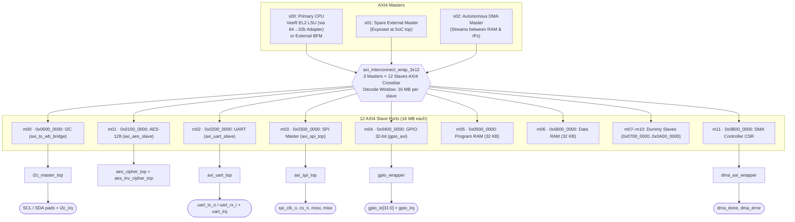

<div align="center">

# 🔐 Secure IoT Gateway SoC

**An AXI4 interconnect-centric SoC that connects a RISC‑V VeeR EL2 core (or AXI bus-functional models) and an autonomous DMA engine to I2C, AES‑128, UART, SPI, GPIO, and on-chip SRAMs — verified with directed NIST test vectors and full multi-IP simulation on Synopsys VCS + Verdi and Vivado.**

[](https://github.com/guntabhumesh/Secure-IoT-Gateway-SoC)
[](rtl)
[-0b7285)](rtl/interconnect/axi_interconnect_wrap_3x12.v)
[](rtl/top/soc_top_with_veer.v)
[-c92a2a)](rtl/aes/rtl/axi_aes_slave.v)
[](rtl/wrappers/dma_axi_wrapper_v.sv)

[Overview](#-overview) · [Architecture](#-architecture) · [Address Map](#-soc-address-map) · [Registers](#-register-maps) · [Quick Start](#-quick-start) · [Verification](#-verification) · [Module Reference](#-module-reference) · [Roadmap](#-roadmap)

</div>

---

## 📑 Table of Contents

1. [Overview](#-overview)
2. [Key Highlights](#-key-highlights)
3. [Architecture](#-architecture)
4. [SoC Address Map](#-soc-address-map)
5. [Repository Layout](#-repository-layout)
6. [Module Reference](#-module-reference)
7. [Register Maps](#-register-maps)
8. [Quick Start & Simulation](#-quick-start--simulation)
9. [Firmware Notes (VeeR EL2)](#-firmware-notes-veer-el2)
10. [Verification & Testbenches](#-verification--testbenches)
11. [Current Status & Roadmap](#-current-status--roadmap)

---

## 🧭 Overview

The **Secure IoT Gateway SoC** is built to securely and autonomously acquire sensor data, encrypt the telemetry in hardware, and stream it to an uplink interface:

| Role in the Gateway | Block | Interface & Connection |
|---|---|---|
| Sensor / Peripheral Bus | **I2C Master** | Wishbone B4 behind [`axi_to_wb_bridge.v`](tb/axi_to_wb_bridge.v) |
| High-Speed Sensor / Flash | **SPI Master** | Native AXI4-Lite slave with ratio clock generator |
| Parallel IO / Control | **GPIO (32-bit)** | AXI4-Lite slave adapter with direction & interrupt registers |
| Hardware Security | **AES‑128 Engine** | AXI4 slave with auto-chained inverse decryption |
| Bulk Data Movement | **DMA Controller** | Autonomous AXI4 master (`s02`) + CSR slave (`m11`) |
| On-Chip Storage | **Prog & Data RAMs** | Dual 32 KB AXI4 synchronous SRAM blocks |
| Telemetry Uplink / Console | **UART** | AXI4 wrapper buffering address skew to AXI-Lite core |
| Primary Processor | **RISC‑V VeeR EL2** | 32-bit core on `s00` via 64-to-32b width adapter |
| Fabric Crossbar | **3 × 12 AXI4 Interconnect** | Arbitration, address decoding, 16 MB window per slave |

---

## ✨ Key Highlights

- **3 × 12 AXI4 Crossbar** ([`axi_interconnect_wrap_3x12.v`](rtl/interconnect/axi_interconnect_wrap_3x12.v)): 3 masters (`s00` CPU/BFM, `s01` Spare master, `s02` DMA) arbitrated across 12 slave ports (16 MB window each).
- **Autonomous DMA Streaming**: DMA engine operates as an independent AXI master (`s02`) to move data between peripherals and RAM without CPU cycle overhead.
- **Hardware AES-128 Encrypt & Auto-Decrypt**: One `LD` trigger pulse starts encryption (~11 cycles) and automatically pre-arms the inverse cipher key schedule to perform round-trip decryption.
- **VeeR EL2 RISC-V Integration**: 64→32-bit LSU adapter ([`axi_64to32_adapter.sv`](rtl/top/axi_64to32_adapter.sv)), ICCM instruction execution, JTAG debug, and trace retirement bus.
- **Dual Dual-Port SRAMs**: Separate 32 KB Program RAM (`0x0500_0000`) and 32 KB Data RAM (`0x0600_0000`).
- **Comprehensive Verification Suite**: Includes full-SoC testbench ([`tb_soc_all_ips.sv`](tb/tb_soc_all_ips.sv)), autonomous DMA verification ([`tb_soc_dma_interconnect.sv`](tb/tb_soc_dma_interconnect.sv)), standalone UART testbench ([`soc_uart_tb.v`](tb/soc_uart_tb.v)), and CPU firmware smoke tests.

---

## 🏗 Architecture

### System Block Diagram



### Intended Data Pipeline

$$\text{Sensor (I2C/SPI)} \xrightarrow{\text{DMA Transfer (s02)}} \text{Data RAM (m06)} \xrightarrow{\text{AES-128 (m01)}} \text{Data RAM} \xrightarrow{\text{DMA / UART (m02)}} \text{Host Uplink}$$

---

## 🗺 SoC Address Map

Each slave interface occupies a naturally aligned **16 MB ($2^{24}$ bytes)** address window:

| Slave Port | Base Address | Address Range | Connected Peripheral | Protocol / Wrapper |
|:---:|:---:|:---:|---|---|
| `m00` | `0x0000_0000` | `0x0000_0000 - 0x00FF_FFFF` | I2C Master Controller | Wishbone B4 via [`axi_to_wb_bridge.v`](tb/axi_to_wb_bridge.v) |
| `m01` | `0x0100_0000` | `0x0100_0000 - 0x01FF_FFFF` | AES-128 Accelerator | AXI4 32-bit via [`axi_aes_slave.v`](rtl/aes/rtl/axi_aes_slave.v) |
| `m02` | `0x0200_0000` | `0x0200_0000 - 0x02FF_FFFF` | UART IP Core | AXI4-Lite via [`axi_uart_slave.v`](rtl/uart/src/rtl/axi_uart_slave.v) |
| `m03` | `0x0300_0000` | `0x0300_0000 - 0x03FF_FFFF` | SPI Master Controller | AXI4-Lite via [`axi_spi_top.v`](rtl/spi/src/rtl/axi_spi_top.v) |
| `m04` | `0x0400_0000` | `0x0400_0000 - 0x04FF_FFFF` | GPIO (32-bit) Subsystem | AXI4-Lite via [`gpio_axi.sv`](rtl/gpio/rtl/verilog/gpio_axi.sv) |
| `m05` | `0x0500_0000` | `0x0500_0000 - 0x05FF_FFFF` | Program RAM (32 KB) | Native AXI4 Slave ([`axi_ram.sv`](rtl/interconnect/axi_ram.sv)) |
| `m06` | `0x0600_0000` | `0x0600_0000 - 0x06FF_FFFF` | Data RAM (32 KB) | Native AXI4 Slave ([`axi_ram.sv`](rtl/interconnect/axi_ram.sv)) |
| `m07` | `0x0700_0000` | `0x0700_0000 - 0x07FF_FFFF` | Reserved Dummy Slave 7 | AXI4 Stub ([`dummy_axi_slave.v`](tb/dummy_axi_slave.v)) |
| `m08` | `0x0800_0000` | `0x0800_0000 - 0x08FF_FFFF` | Reserved Dummy Slave 8 | AXI4 Stub ([`dummy_axi_slave.v`](tb/dummy_axi_slave.v)) |
| `m09` | `0x0900_0000` | `0x0900_0000 - 0x09FF_FFFF` | Reserved Dummy Slave 9 | AXI4 Stub ([`dummy_axi_slave.v`](tb/dummy_axi_slave.v)) |
| `m10` | `0x0A00_0000` | `0x0A00_0000 - 0x0AFF_FFFF` | Reserved Dummy Slave 10 | AXI4 Stub ([`dummy_axi_slave.v`](tb/dummy_axi_slave.v)) |
| `m11` | `0x0B00_0000` | `0x0B00_0000 - 0x0BFF_FFFF` | DMA Controller CSR | AXI4-Lite via [`dma_axi_wrapper_v.sv`](rtl/wrappers/dma_axi_wrapper_v.sv) |

---

## 📁 Repository Layout

```text
Secure-IoT-Gateway-SoC/
├── README.md
├── doc/
│   ├── Secure_IoT_Gateway_Architecture_Document.md      # Full architecture specification
│   ├── Secure_IoT_Gateway_Architecture_Document-1.pdf   # Updated PDF specification
│   ├── Secure_IoT_Gateway_Abstract.pdf                  # Project abstract
│   └── Secure_IoT_Gateway_SoC_Compact_Register_Map.xlsx # Updated multi-sheet Excel register map
├── rtl/
│   ├── interconnect/
│   │   ├── soc_top.v                       # ASIC/BFM integration top level
│   │   ├── axi_interconnect_wrap_3x12.v    # 3x12 crossbar wrapper
│   │   ├── axi_interconnect.v              # AXI4 crossbar switch engine
│   │   ├── arbiter.v / priority_encoder.v  # Round-robin arbitration logic
│   │   └── axi_ram.sv                      # 32 KB synchronous memory module
│   ├── top/
│   │   ├── soc_top_with_veer.v / .sv       # Full SoC top with VeeR EL2 CPU
│   │   └── axi_64to32_adapter.sv           # VeeR 64-bit LSU to 32-bit SoC adapter
│   ├── core/                               # CHIPS Alliance VeeR EL2 RISC-V core RTL
│   ├── aes/                                # AES-128 forward/inverse cipher + axi_aes_slave
│   ├── uart/                               # 16550-compatible UART core + axi_uart_slave
│   ├── i2c/                                # OpenCores I2C Master controller
│   ├── spi/                                # High-speed SPI master IP
│   ├── gpio/                               # 32-bit bidirectional GPIO with interrupts
│   ├── dma/                                # Multi-channel DMA controller
│   └── wrappers/
│       └── dma_axi_wrapper_v.sv            # Verilog wire-level wrapper for DMA
├── tb/
│   ├── tb_soc_vips.sv                      # Integrated SoC testbench with active UVM VIPs
│   ├── tb_soc_testplan.v                   # UVM testplan verification testbench (12 tests)
│   ├── tb_soc_all_ip_veer.v                # Full SoC multi-IP testbench with VeeR EL2 CPU
│   ├── vips/                               # Protocol-aware UVM VIP components
│   │   ├── uart_vip.sv                     # UART VIP monitor & scoreboard
│   │   ├── spi_vip.sv                      # SPI VIP monitor & scoreboard
│   │   ├── i2c_vip.sv                      # I2C VIP monitor & scoreboard
│   │   ├── gpio_vip.sv                     # GPIO VIP monitor & scoreboard
│   │   └── soc_vip_pkg.sv                  # UVM package, environment & test classes
│   ├── tb_soc_all_ips.sv                   # Comprehensive testbench verifying all 12 ports
│   ├── tb_soc_dma_interconnect.sv          # Autonomous DMA transfer verification
│   ├── soc_uart_tb.v                       # Dedicated standalone UART testbench
│   ├── tb_soc_top.v                        # 12-test directed base verification
│   ├── tb_soc_veer_top.v                   # CPU firmware execution & UART loopback
│   ├── tb_spi_gpio_vcs.sv                  # Dedicated SPI and GPIO testbench
│   ├── axi_to_wb_bridge.v                  # AXI4-Lite to Wishbone bridge
│   └── dummy_axi_slave.v                   # Bus responder stub for unmapped slots
├── firmware/
│   ├── soc_testplan.c                      # Embedded C firmware for 12 UVM testplan cases
│   ├── soc_all_ip_test.c                   # Multi-IP peripheral test firmware
│   ├── soc_test.c                          # C firmware for VeeR EL2 ICCM execution
│   └── startup.S / link_iccm.ld            # Boot code and linker script
├── run/
│   ├── run_soc_vips.sh / .f                # SoC + active UVM VIPs build, simulation & Verdi runner
│   ├── run_soc_testplan.sh / .f            # Full SoC UVM testplan runner & filelist
│   ├── run_soc_all_ip_veer.sh / .f         # Multi-IP SoC + VeeR simulation runner
│   └── run_uvm.sh                          # Standalone interface UVM VIP runner (UART/SPI/I2C/GPIO)
└── scripts/
    ├── build/build_soc_project.tcl         # Vivado FPGA build project script
    ├── sim/run_all_ips_sim.tcl             # Simulation script for full SoC verification
    └── interfacecsv/                       # VIP virtual interface definitions & CSV specs
```

---

## 🧩 Module Reference

| Module | File | Role & Function |
|---|---|---|
| `soc_top` | [`rtl/interconnect/soc_top.v`](rtl/interconnect/soc_top.v) | System top level wiring 3 masters, 12 slaves, and peripheral IOs |
| `soc_top_with_veer` | [`rtl/top/soc_top_with_veer.sv`](rtl/top/soc_top_with_veer.sv) | Full SoC integrating VeeR EL2 CPU, width adapter, and ICCM SRAMs |
| `axi_interconnect_wrap_3x12` | [`rtl/interconnect/axi_interconnect_wrap_3x12.v`](rtl/interconnect/axi_interconnect_wrap_3x12.v) | Port-expanded 3x12 crossbar wrapper with 16 MB windows |
| `axi_64to32_adapter` | [`rtl/top/axi_64to32_adapter.sv`](rtl/top/axi_64to32_adapter.sv) | Converts VeeR's 64-bit LSU bus to 32-bit SoC bus |
| `axi_to_wb_bridge` | [`tb/axi_to_wb_bridge.v`](tb/axi_to_wb_bridge.v) | Translates 32-bit AXI4-Lite accesses to 8-bit Wishbone B4 (I2C) |
| `axi_aes_slave` | [`rtl/aes/rtl/axi_aes_slave.v`](rtl/aes/rtl/axi_aes_slave.v) | AXI4 register wrapper with auto-chained inverse decryption |
| `axi_uart_slave` | [`rtl/uart/src/rtl/axi_uart_slave.v`](rtl/uart/src/rtl/axi_uart_slave.v) | Buffers `AW` address to prevent write skew lockups in UART |
| `axi_spi_top` | [`rtl/spi/src/rtl/axi_spi_top.v`](rtl/spi/src/rtl/axi_spi_top.v) | SPI Master core with programmable clock ratio and FIFO |
| `gpio_axi` | [`rtl/gpio/rtl/verilog/gpio_axi.sv`](rtl/gpio/rtl/verilog/gpio_axi.sv) | 32-bit GPIO controller with direction, input read, and IRQ |
| `axi_ram` | [`rtl/interconnect/axi_ram.sv`](rtl/interconnect/axi_ram.sv) | 32 KB synchronous memory used for Program and Data RAM |
| `dma_axi_wrapper_v` | [`rtl/wrappers/dma_axi_wrapper_v.sv`](rtl/wrappers/dma_axi_wrapper_v.sv) | Adapts DMA SystemVerilog structs to discrete Verilog wire buses |

---

## 📖 Register Maps

Detailed register maps and bitfield descriptions are documented in [`doc/Secure_IoT_Gateway_Architecture_Document.md`](doc/Secure_IoT_Gateway_Architecture_Document.md) and formatted in the Excel workbook [`doc/Secure_IoT_Gateway_SoC_Compact_Register_Map.xlsx`](doc/Secure_IoT_Gateway_SoC_Compact_Register_Map.xlsx).

* **I2C (`0x0000_0000`)**: `PRER_LO` (`0x00`), `PRER_HI` (`0x04`), `CTR` (`0x08`), `TXR/RXR` (`0x0C`), `CR/SR` (`0x10`).
* **AES-128 (`0x0100_0000`)**: `CTRL_STATUS` (`0x00`), `KEY0..3` (`0x04..10`), `TEXT0..3` (`0x14..20`), `OUT0..3` (`0x24..30`), `DOUT0..3` (`0x34..40`).
* **UART (`0x0200_0000`)**: `THR/RBR` (`0x00`), `IER` (`0x04`), `BAUD` (`0x08`), `LCR` (`0x0C`), `LSR` (`0x14`).
* **SPI (`0x0300_0000`)**: `RCLK` (`0x30`), `CR` (`0x60`), `SR` (`0x64`), `DTR` (`0x68`), `DRR` (`0x6C`), `SSR` (`0x70`).
* **GPIO (`0x0400_0000`)**: `DATA_I` (`0x00`), `DATA_O` (`0x04`), `DIR` (`0x08`).
* **DMA CSR (`0x0B00_0000`)**: `DMA_CONTROL` (`0x00`), `DMA_STATUS` (`0x08`), `DESC0_SRC_ADDR` (`0x20`), `DESC0_DST_ADDR` (`0x28`), `DESC0_NUM_BYTES` (`0x30`), `DESC0_CFG` (`0x38`).

---

## 🚀 Quick Start & Simulation

### 1. Integrated SoC Simulation with Active UVM VIPs (`tb_soc_vips.sv`)
Preloads the RISC-V C firmware testplan into 4-bank ICCM & DCCM with 7-bit SECDED ECC, boots the VeeR EL2 core, and validates all external transactions using protocol-aware UVM VIP scoreboards (UART, SPI, I2C, GPIO) with FSDB waveform generation.

```bash
# Automated runner from repo root (fw -> compile -> sim):
./run/run_soc_vips.sh all

# Or run from inside run/:
cd run && ./run_soc_vips.sh all

# Individual step commands:
./run/run_soc_vips.sh fw       # Build C firmware to 4-bank ECC hex
./run/run_soc_vips.sh compile  # Compile RTL + UVM VIPs with Synopsys VCS
./run/run_soc_vips.sh sim      # Run simulation (dumps dump_soc_vips.fsdb)
./run/run_soc_vips.sh wave     # Open waveforms in Verdi
```

**Direct Synopsys VCS & Verdi Commands:**
```bash
# VCS Compile:
vcs -full64 -sverilog -ntb_opts uvm -timescale=1ns/1ps -debug_access+all -kdb \
    -P $VERDI_HOME/share/PLI/VCS/LINUX64/novas.tab \
       $VERDI_HOME/share/PLI/VCS/LINUX64/pli.a \
    +define+FSDB \
    -f run/run_soc_vips.f -l run/compile_vips.log -o simv_soc_vips

# Run Simulation:
./simv_soc_vips +UVM_TESTNAME=soc_c_test +hex_file=firmware/soc_testplan.hex -no_save +vcs+lic+wait -l sim_soc_vips.log

# Open in Verdi Waveform Viewer:
verdi -dbdir simv_soc_vips.daidir -ssf dump_soc_vips.fsdb &
```

---

### 2. Full SoC UVM Testplan Verification (`tb_soc_testplan.v`)
Executes all 12 test cases from the UVM test plan (UART loopback, Core memory sign extension, DCCM patterns, AES-128 NIST KAT, SPI multi-byte transfer, GPIO atomic SET/CLR/TGL, I2C multi-byte transmission, SRAM byte-strobes, DMA autonomous burst transfer, General Timer countdown & W1C clear, Dummy slaves decoding, and End-to-end SoC mission status):

```bash
# Automated runner:
./run/run_soc_testplan.sh all

# Direct VCS & Verdi:
vcs -full64 -sverilog -ntb_opts uvm -timescale=1ns/1ps -debug_access+all -kdb \
    -P $VERDI_HOME/share/PLI/VCS/LINUX64/novas.tab \
       $VERDI_HOME/share/PLI/VCS/LINUX64/pli.a \
    +define+FSDB \
    -f run/run_soc_testplan.f -l run/compile_testplan.log -o simv_testplan

./simv_testplan +hex_file=firmware/soc_testplan.hex -no_save +vcs+lic+wait

# Open in Verdi:
verdi -dbdir simv_testplan.daidir -ssf dump_soc_testplan.fsdb -sswr tb/soc_testplan.rc &
```

---

### 3. Multi-IP Full SoC Simulation with VeeR CPU (`tb_soc_all_ip_veer.v`)
```bash
./run/run_soc_all_ip_veer.sh all

# Open in Verdi:
verdi -dbdir simv.daidir -ssf dump_all_ip.fsdb &
```

---

### 4. Interface UVM Verification Suite (`run/run_uvm.sh`)
Executes individual interface UVM VIP testbenches for AXI, UART, GPIO, SPI, I2C, and JTAG:
```bash
./run/run_uvm.sh all      # Run all 6 interface UVM tests
./run/run_uvm.sh uart     # Run UART interface testbench
./run/run_uvm.sh gpio     # Run GPIO interface testbench
./run/run_uvm.sh spi      # Run SPI interface testbench
./run/run_uvm.sh i2c      # Run I2C interface testbench
./run/run_uvm.sh jtag     # Run JTAG interface testbench
```

---

### 5. Multi-IP Bus-Functional Simulation & Vivado
```bash
# Full Multi-IP directed simulation (BFM)
./run/run_soc_all_ips_bfm.sh  # or via Vivado
vivado -mode batch -source scripts/build/build_soc_project.tcl
```

---

## ✅ Verification & Testbenches

| Testbench | Focus Area | Checks & Assertions |
|---|---|---|
| [`tb_soc_vips.sv`](tb/tb_soc_vips.sv) | Active UVM VIP Environment | Validates physical bus transitions on UART, SPI, I2C, and GPIO via protocol scoreboards while running C testplan |
| [`tb_soc_testplan.v`](tb/tb_soc_testplan.v) | Full SoC UVM Test Plan | Executes all 12 testplan cases on VeeR EL2 CPU with ECC ICCM/DCCM preloading and UART output checking |
| [`tb_soc_all_ip_veer.v`](tb/tb_soc_all_ip_veer.v) | CPU Firmware Multi-IP | Boots VeeR core from ICCM and verifies interaction with all 11 SoC slave peripherals |
| [`tb_soc_all_ips.sv`](tb/tb_soc_all_ips.sv) | Full SoC BFM Integration | Configures & verifies I2C, AES NIST vectors, UART TX, SPI master, GPIO, Program/Data RAMs, and DMA CSR |
| [`tb_soc_dma_interconnect.sv`](tb/tb_soc_dma_interconnect.sv) | DMA Fabric Interaction | Tests DMA autonomous read/write streaming across interconnect master port `s02` |
| [`soc_uart_tb.v`](tb/soc_uart_tb.v) | UART Standalone | Tests baud rate divider setup, FIFO pushing, `LSR.THRE`, hardware loopback, and multi-byte string echo |
| [`tb_soc_top.v`](tb/tb_soc_top.v) | Base Peripheral Suite | 12 directed tests covering I2C, AES Appendices B & C.1, UART, and dummy-slave routing |
| [`tb_soc_veer_top.v`](tb/tb_soc_veer_top.v) | CPU Firmware Boot | Preloads ICCM with compiled `.hex`, boots VeeR EL2 core, and verifies execution via UART output |
| [`tb_spi_gpio_vcs.sv`](tb/tb_spi_gpio_vcs.sv) | SPI & GPIO Standalone | Directed VCS test verifying SPI ratio clock generation, mode bits, and GPIO pin toggling |
| [`tb_soc_veer_top.v`](tb/tb_soc_veer_top.v) | CPU Firmware Boot | Preloads ICCM with compiled `.hex`, boots VeeR EL2 core, and verifies execution via UART output |
| [`tb_spi_gpio_vcs.sv`](tb/tb_spi_gpio_vcs.sv) | SPI & GPIO Standalone | Directed VCS test verifying SPI ratio clock generation, mode bits, and GPIO pin toggling |

---

## 🛣 Current Status & Roadmap

### Completed Milestones
- [x] **3 × 12 AXI4 Crossbar**: Implemented, tested, and validated with 16 MB window decoding.
- [x] **SPI Master IP**: Fully integrated into port `m03` and verified with VCS simulation.
- [x] **DMA Subsystem**: Master port `s02` and CSR slave port `m11` fully connected and verified.
- [x] **GPIO Subsystem**: 32-bit bidirectional controller on port `m04` with AXI-Lite adapter.
- [x] **On-Chip SRAMs**: Dual 32 KB synchronous Program and Data memories on ports `m05` and `m06`.
- [x] **Standalone UART Testbench**: Fully implemented and self-checking ([`tb/soc_uart_tb.v`](tb/soc_uart_tb.v)).
- [x] **Documentation & Register Map Synchronization**: Updated [`README.md`](README.md), generated [`Secure_IoT_Gateway_Architecture_Document.md`](doc/Secure_IoT_Gateway_Architecture_Document.md), updated [`Secure_IoT_Gateway_Architecture_Document-1.pdf`](doc/Secure_IoT_Gateway_Architecture_Document-1.pdf), and aligned [`Secure_IoT_Gateway_SoC_Compact_Register_Map.xlsx`](doc/Secure_IoT_Gateway_SoC_Compact_Register_Map.xlsx).
- [x] **Workspace Hygiene**: Cleaned up leftover scratch patch files (`target.txt`, `replacement.txt`).

### Remaining Next Steps
- [ ] **PIC Interrupt Routing**: Wire peripheral interrupt lines (`i2c_irq`, `uart_irq`, `gpio_irq`, `dma_done`) to the VeeR EL2 core's Programmable Interrupt Controller input (`extintsrc_req`) in `soc_top_with_veer.sv`.
- [ ] **General Timer Integration**: Connect the existing `timer_axi.sv` core to an available slot (e.g. `m07`) in `soc_top.v` and hook `timer_int` to the CPU.
- [ ] **Unified End-to-End Firmware Application**: Assemble a full C application running on VeeR EL2 executing the complete automated sequence: $\text{Sensor (I2C/SPI)} \rightarrow \text{DMA} \rightarrow \text{RAM} \rightarrow \text{AES-128} \rightarrow \text{UART Transmit}$.
