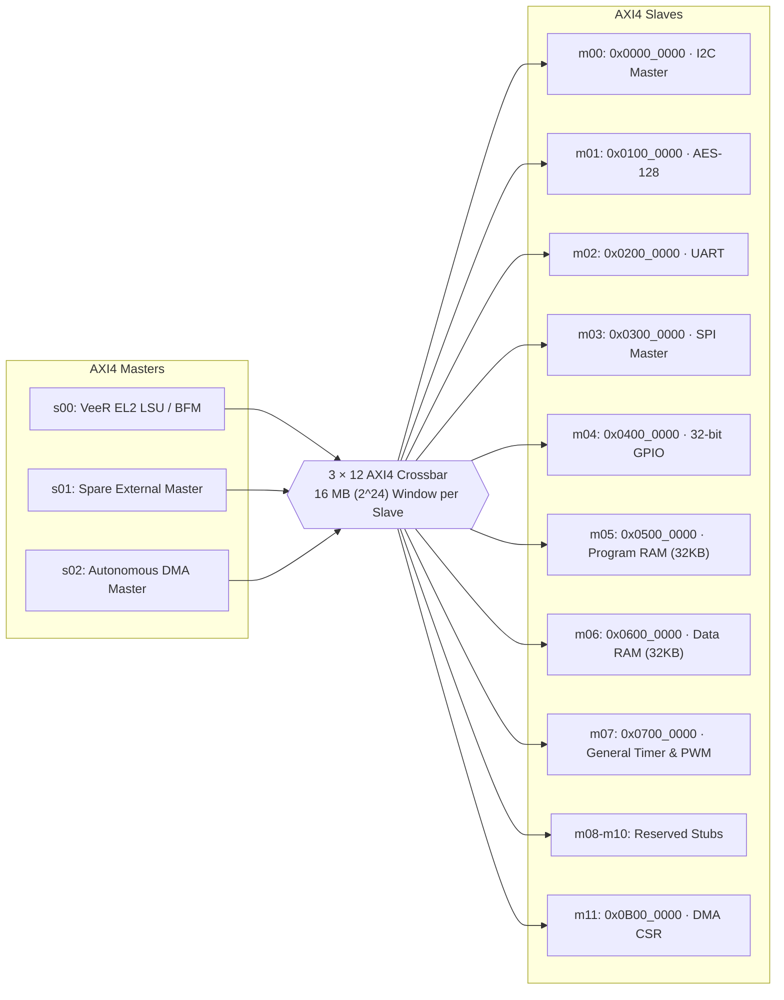

# 🏛️ Secure IoT Gateway SoC — Architecture Specification

## 1. System Overview

The **Secure IoT Gateway SoC** is a modular, high-security edge processing platform based on the RISC-V VeeR EL2 core and an AXI4 interconnect crossbar. It performs real-time sensor telemetry acquisition, hardware-accelerated encryption/decryption, and autonomous data streaming with minimal CPU involvement.

### Key Objectives
* **Sensor Acquisition**: Supports low-speed serial (I2C) and high-speed synchronous (SPI) sensors alongside parallel 32-bit GPIO inputs.
* **Hardware Security**: Integrated NIST FIPS-197 AES-128 cryptographic engine executing 128-bit block encryptions in ~11 clock cycles with auto-chained inverse decryption.
* **Autonomous Bulk Movement**: Integrated DMA controller relieves the RISC-V core from copying byte-by-byte payloads between peripherals and memory.
* **Communication & Console**: AXI-Lite UART core with independent TX/RX FIFOs and programmable baud generator.
* **Flexible Verification**: Standalone BFM-driven integration top (`soc_top.v`) and full CPU-in-the-loop top (`soc_top_with_veer.v/.sv`).

---

## 2. Interconnect Architecture & Data Flow

The system fabric is built around a **3-Master × 12-Slave AXI4 Crossbar** (`axi_interconnect_wrap_3x12`).

### End-to-End Pipeline
$$\text{Sensor (I2C / SPI)} \xrightarrow{\text{DMA Transfer (s02)}} \text{Data RAM (m06)} \xrightarrow{\text{AES-128 (m01)}} \text{Data RAM} \xrightarrow{\text{DMA / UART (m02)}} \text{Uplink}$$

---

## 3. SoC Memory Map

Each slave interface occupies a naturally aligned **16 MB ($2^{24}$ bytes)** address window:

| Slave Port | Base Address | Address Range | Size | Connected Subsystem | Description |
|:---:|:---:|:---:|:---:|---|---|
| `m00` | `0x0000_0000` | `0x0000_0000 - 0x00FF_FFFF` | 16 MB | `i2c_master_top` (via WB bridge) | Sensor I2C Master controller |
| `m01` | `0x0100_0000` | `0x0100_0000 - 0x01FF_FFFF` | 16 MB | `axi_aes_slave` (AES-128) | NIST FIPS-197 Crypto Engine |
| `m02` | `0x0200_0000` | `0x0200_0000 - 0x02FF_FFFF` | 16 MB | `axi_uart_slave` (`axi_uart_top`) | Telemetry & debug serial console |
| `m03` | `0x0300_0000` | `0x0300_0000 - 0x03FF_FFFF` | 16 MB | `axi_spi_top` | High-speed SPI Master bus |
| `m04` | `0x0400_0000` | `0x0400_0000 - 0x04FF_FFFF` | 16 MB | `gpio_axi` | 32-bit Bidirectional GPIO with IRQ |
| `m05` | `0x0500_0000` | `0x0500_0000 - 0x05FF_FFFF` | 16 MB | `axi_ram` (Program Memory) | 32 KB On-chip code execution SRAM |
| `m06` | `0x0600_0000` | `0x0600_0000 - 0x06FF_FFFF` | 16 MB | `axi_ram` (Data Memory) | 32 KB On-chip sensor & crypto buffer |
| `m07` | `0x0700_0000` | `0x07FF_FFFF` | 16 MB | `timer_axi` | 32-bit General Timer & PWM Generator with Input Capture |
| `m08` | `0x0800_0000` | `0x0800_0000 - 0x08FF_FFFF` | 16 MB | `dummy_axi_slave` (Index 8) | Reserved expansion slot |
| `m09` | `0x0900_0000` | `0x0900_0000 - 0x09FF_FFFF` | 16 MB | `dummy_axi_slave` (Index 9) | Reserved expansion slot |
| `m10` | `0x0A00_0000` | `0x0A00_0000 - 0x0AFF_FFFF` | 16 MB | `dummy_axi_slave` (Index 10) | Reserved expansion slot |
| `m11` | `0x0B00_0000` | `0x0B00_0000 - 0x0BFF_FFFF` | 16 MB | `dma_axi_wrapper_v` (`csr_dma`) | DMA Control, Status & Descriptors |

---

## 4. Register Maps

### 4.1 I2C Master (`0x0000_0000`)
* **`0x00` (PRER_LO)**: Prescaler lower byte (R/W).
* **`0x04` (PRER_HI)**: Prescaler upper byte (R/W). Formula: $\text{prescale} = \frac{f_{\text{clk}}}{5 \times f_{\text{scl}}} - 1$.
* **`0x08` (CTR)**: Control Register (R/W). `[7]` = Enable Core (`EN`), `[6]` = Enable Interrupt (`IEN`).
* **`0x0C` (TXR / RXR)**: Data Transmit (WO) / Data Receive (RO).
* **`0x10` (CR / SR)**: Command Register (WO: `STA`, `STO`, `RD`, `WR`, `ACK`, `IACK`) / Status Register (RO: `RxACK`, `Busy`, `AL`, `TIP`, `IF`).

### 4.2 AES-128 Engine (`0x0100_0000`)
* **`0x00` (CTRL_STATUS)**: Control & Status Register (R/W):
  * `Bit [0]` (`LD`): Start encryption pulse. Automatically primes inverse cipher key expansion.
  * `Bit [1]` (`KLD`): Key-only load pulse.
  * `Bit [2]` (`RST`): Soft reset.
  * `Bit [16]` (`DONE`): Encryption complete sticky status.
  * `Bit [17]` (`KDONE`): Key load complete sticky status.
* **`0x04 - 0x10` (KEY0 - KEY3)**: 128-bit Encryption Key (`KEY0` = `[127:96]` ... `KEY3` = `[31:0]`).
* **`0x14 - 0x20` (TEXT0 - TEXT3)**: 128-bit Plaintext Input (`TEXT0` = `[127:96]` ... `TEXT3` = `[31:0]`).
* **`0x24 - 0x30` (OUT0 - OUT3)**: 128-bit Ciphertext Output (RO).
* **`0x34 - 0x40` (DOUT0 - DOUT3)**: 128-bit Decrypted Plaintext Output from auto-chained inverse cipher (RO).

### 4.3 UART Interface (`0x0200_0000`)
* **`0x00` (THR / RBR)**: Transmit Holding Register (WO) / Receive Buffer Register (RO). Accessible when `LCR[7] (DLAB) = 0`.
* **`0x04` (IER)**: Interrupt Enable Register (R/W). `[0]` = Data Ready IRQ, `[1]` = Transmitter Holding Empty IRQ.
* **`0x08` (BAUD_DIVISOR)**: Baud Rate Divisor (R/W). Accessible when `LCR[7] (DLAB) = 1`. Divisor $= \frac{f_{\text{clk}}}{16 \times \text{baud}}$.
* **`0x0C` (LCR)**: Line Control Register (R/W). `[7]` = DLAB, `[1:0]` = 8N1 word length configuration.
* **`0x14` (LSR)**: Line Status Register (RO). `[6]` = Transmitter Empty (`TEMT`), `[5]` = Transmit Holding Register Empty (`THRE`), `[0]` = Data Ready.

### 4.4 SPI Master (`0x0300_0000`)
* **`0x30` (RCLK)**: Ratio Clock Prescaler register.
* **`0x60` (CR)**: Control Register: `[1]` = SPI Enable, `[2]` = Master Mode, `[3]` = CPOL, `[4]` = CPHA.
* **`0x64` (SR)**: Status Register: `[3]` = TX Full, `[2]` = TX Empty, `[1]` = RX Full, `[0]` = RX Empty.
* **`0x68` (DTR)**: Data Transmit Register (WO).
* **`0x6C` (DRR)**: Data Receive Register (RO).
* **`0x70` (SSR)**: Slave Select Register (active-low chip select vector).

### 4.5 GPIO Subsystem (`0x0400_0000`)
* **`0x00` (DATA_I)**: 32-bit Physical IO Pin Readback (RO).
* **`0x04` (DATA_O)**: 32-bit Output Data Register (R/W).
* **`0x08` (DIR)**: 32-bit Pin Direction Register (`1` = Output, `0` = Input).

### 4.6 General Timer & PWM (`0x0700_0000`)
* **`0x00` (CTRL)**: Control Register (R/W): `[0]` = EN, `[1]` = MODE (0: One-shot, 1: Periodic), `[2]` = PRE_EN, `[3]` = DIR (0: Down, 1: Up), `[4]` = PWM_EN, `[5]` = EXT_EN, `[6]` = CAP_EN.
* **`0x04` (LOAD)**: 32-bit Timer Load / Reload Value (R/W).
* **`0x08` (VAL)**: 32-bit Live Counter Value Readback (RO).
* **`0x0C` (PRE)**: 16-bit Prescaler Clock Divider (R/W).
* **`0x10` (INT_EN)**: Interrupt Enable (R/W): `[0]` = Timer Expire IRQ, `[1]` = Capture IRQ.
* **`0x14` (INT_STS)**: Interrupt Status (W1C): `[0]` = Timer Expire Pending, `[1]` = Capture Event Pending.
* **`0x18` (CMP)**: 32-bit PWM Compare Threshold Value (R/W).
* **`0x1C` (CAP)**: 32-bit Input Captured Snapshot Value (RO).

### 4.7 DMA Engine CSR (`0x0B00_0000`)
* **`0x00` (DMA_CONTROL)**: Control: `[0]` = `GO`, `[1]` = `ABORT`, `[7:4]` = `MAX_BURST`.
* **`0x08` (DMA_STATUS)**: Status: `[0]` = `BUSY`, `[1]` = `DONE`, `[2]` = `ERROR`.
* **`0x20` (DESC0_SRC_ADDR)**: Source memory/peripheral address.
* **`0x28` (DESC0_DST_ADDR)**: Destination memory/peripheral address.
* **`0x30` (DESC0_NUM_BYTES)**: Block transfer length in bytes.
* **`0x38` (DESC0_CFG)**: Descriptor configuration: `[0]` = Enable, `[1]` = Write Mode, `[2]` = Read Mode.

---

## 5. Processor & Core Adapter Architecture

### 5.1 VeeR EL2 RISC-V Integration
* **Instruction Execution**: Boot vector at `0x8000_0000`. Default configuration executes from internal banked **Instruction Closely Coupled Memory (ICCM)** at `0xEE00_0000`.
* **Bus Adaptation**: VeeR EL2 LSU outputs a **64-bit data bus with 3-bit ID**. The `axi_64to32_adapter.sv` bridges this to the SoC fabric:
  * Single-beat writes: Decodes `AWADDR[2]` to forward the relevant 32-bit word and compress 8-bit strobes to 4-bit strobes.
  * Single-beat reads: Zero-extends 32-bit read data to 64 bits.
  * ID padding: Expands 3-bit core tags to 8-bit interconnect tags and truncates back on responses.
